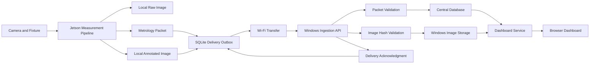

# Networked Metrology Data and Dashboard Subsystem

## Document status

**Status:** Proposed architecture<br>
**Project:** CaseMetrology<br>
**Researcher:** Timmy Bell<br>
**Degree program:** M.S. Integrated Systems Design and Dynamics<br>
**Purpose:** Define the architecture, interfaces, reliability behavior, and verification requirements for transferring metrology results from the Jetson to a Windows-hosted database and real-time dashboard.

This document defines the subsystem architecture before implementation. The final measurement fields will be confirmed after the cartridge-case OAL pilot.

## System objective

Extend CaseMetrology so that each accepted Jetson measurement can:

1. Remain preserved locally on the Jetson
2. Produce a traceable metrology packet
3. Enter a durable local delivery queue
4. Transfer over Wi-Fi to a Windows receiver
5. Be validated before database insertion
6. Store an associated annotated image
7. Appear on a browser-based dashboard in near real time
8. Survive temporary network or Windows-system outages without data loss

## Architectural principle

The Jetson is the authoritative source of each measurement record.

The Windows system receives and stores a verified copy for centralized visualization, analysis, and historical review.

Network availability shall not determine whether a measurement can be completed or preserved locally.

## System boundary

### Included

- Jetson measurement-result generation
- Local raw and annotated image storage
- Local JSON metrology-packet creation
- Durable delivery queue
- Wi-Fi transport
- Windows ingestion service
- Packet and image validation
- Central database
- Windows annotated-image storage
- Real-time dashboard
- Delivery acknowledgment
- Retry and duplicate-prevention behavior
- System-event logging
- Verification of transfer integrity and latency

### Excluded from the initial implementation

- PLC control
- Automatic machine stopping
- Automated reject actuation
- Conveyor triggering
- Cloud hosting
- Mobile application
- Enterprise authentication
- Production cybersecurity certification
- Regulatory or customer production approval

## High-level architecture



## Subsystem responsibilities

### Jetson measurement subsystem

The Jetson shall:

- Acquire the image
- Produce the dimensional result
- Save the original image locally
- Save the annotated image locally
- Create the metrology packet
- Calculate the annotated-image SHA-256 hash
- Add the packet to a durable local outbox
- Attempt delivery to Windows
- Retain undelivered packets
- Retry failed deliveries
- Mark a packet delivered only after acknowledgment
- Preserve delivery and failure events

### Jetson local outbox

The local outbox shall use SQLite or an equivalently durable local store.

Each record shall contain:

- Packet identifier
- Session identifier
- Part identifier
- Packet payload
- Annotated-image path
- Annotated-image SHA-256 hash
- Queue status
- Attempt count
- Last-attempt timestamp
- Delivered timestamp
- Last error
- Windows acknowledgment identifier

Recommended queue states:

- `PENDING`
- `SENDING`
- `DELIVERED`
- `RETRY`
- `FAILED_REVIEW`

A system restart shall not delete or reset pending packets.

### Wi-Fi transport

The initial implementation shall use the existing local network or secure private network connection between the Jetson and Windows computer.

The transport shall:

- Use HTTP or HTTPS
- Send the JSON packet and annotated image together or through a defined two-step transaction
- Use a delivery timeout
- Return an explicit acknowledgment
- Support safe retry
- Avoid treating a connection failure as measurement failure

### Windows ingestion service

The Windows ingestion service shall:

- Receive the packet and annotated image
- Validate required packet fields
- Reject malformed packets
- Recalculate the image SHA-256 hash
- Compare the received hash with the packet hash
- Enforce packet-ID uniqueness
- Store the annotated image
- Insert or confirm the database record
- Return an acknowledgment only after successful persistence
- Record ingestion and validation failures
- Publish accepted results to the dashboard service

The proposed implementation is a Python FastAPI service.

### Windows database

The proposed central database is PostgreSQL.

The database shall store structured measurement and system information.

Initial logical tables:

| Table | Purpose |
|---|---|
| `sessions` | Session, operator, configuration, calibration, and environment |
| `parts` | Unique part identifiers and reference information |
| `measurements` | Vision values, reference values, error, and disposition |
| `images` | Image names, paths, sizes, and hashes |
| `deliveries` | Packet receipt, acknowledgment, retries, and latency |
| `system_events` | Communication, acquisition, and processing events |

The database shall enforce a unique constraint on `packet_id`.

### Windows image storage

Annotated PNG images shall be stored in the Windows filesystem rather than inside the primary relational database.

Proposed structure:

```text
C:\\CaseMetrologyData\\
├── annotated\\
│   └── YYYY-MM-DD\\
├── packets\\
├── rejected\\
└── logs\\
```

The database shall store:

- Relative or absolute image path
- Filename
- File size
- SHA-256 hash
- Capture timestamp
- Packet identifier
- Session identifier
- Part identifier

The Jetson copy remains the authoritative original.

### Dashboard subsystem

The dashboard shall initially display:

- Most recent annotated image
- Part identifier
- Measurement type
- Vision measurement
- Manual reference, when available
- Signed error
- Pass/fail or research disposition
- Capture timestamp
- Session identifier
- Recent measurement trend
- Running count
- Running mean and standard deviation
- Detection-failure count
- Last Jetson packet time
- Communication status
- Pending Jetson queue count, when available

The dashboard may use:

- FastAPI with a custom browser interface
- WebSocket updates
- Short-interval polling during the first prototype
- Grafana later for historical engineering analytics

The custom dashboard is preferred for the operator-facing annotated-image view.

## End-to-end transaction

The intended transaction is:

1. The Jetson completes a measurement.
2. The Jetson saves the raw image.
3. The Jetson saves the annotated image.
4. The Jetson calculates the image hash.
5. The Jetson creates a packet with a unique `packet_id`.
6. The packet enters the local SQLite outbox.
7. The sender attempts delivery.
8. Windows validates the packet.
9. Windows recalculates and compares the image hash.
10. Windows stores the image.
11. Windows commits the database transaction.
12. Windows returns an acknowledgment.
13. The Jetson marks the outbox record `DELIVERED`.
14. The dashboard displays the accepted result.

## Delivery semantics

The subsystem shall use:

> At-least-once delivery with idempotent receiver behavior

This means the Jetson may retry the same packet, but Windows shall not create duplicate measurement records.

Duplicate prevention shall rely on the unique `packet_id`.

If Windows receives an already stored packet, it shall return a successful idempotent acknowledgment rather than inserting another measurement.

## Failure behavior

### Wi-Fi unavailable

- Measurement continues locally
- Images and packet remain on the Jetson
- Queue status becomes `RETRY`
- Delivery resumes after connectivity returns

### Windows computer unavailable

- Measurement continues locally
- No measurement record is deleted
- Pending packets remain durable
- Dashboard shows stale or offline status
- Packets are transmitted after Windows returns

### Image hash mismatch

- Database measurement shall not be accepted as complete
- Image shall be moved to a rejected or quarantine location
- An event shall be logged
- Jetson packet shall remain pending or require review

### Duplicate packet

- No duplicate measurement row shall be created
- Existing record shall be confirmed
- A successful acknowledgment may be returned

### Database failure

- Windows shall not acknowledge successful delivery
- Jetson shall retain the packet
- Windows shall log the failure
- Retry shall occur later

### Jetson restart

- Pending outbox records shall remain available
- Delivery service shall resume processing after startup
- Previously delivered records shall not be retransmitted unless explicitly requested

## Provisional metrology packet

The exact measurement fields will be locked after the OAL pilot.

```json
{
  "schema_version": "1.0",
  "packet_id": "uuid",
  "session_id": "oal_pilot_YYYYMMDD_HHMMSS",
  "part_id": "CASE-0001",
  "captured_at": "ISO-8601 timestamp",
  "source_host": "timmy-nano",
  "measurement_type": "OAL",
  "measurement_in": null,
  "manual_reference_in": null,
  "signed_error_in": null,
  "absolute_error_in": null,
  "lower_spec_in": null,
  "upper_spec_in": null,
  "result": "PASS",
  "quality_status": "ACCEPTED",
  "annotated_image_filename": "CASE-0001_annotated.png",
  "annotated_image_sha256": "sha256",
  "calibration_id": null,
  "algorithm_version": "provisional",
  "git_commit": "commit",
  "camera_config_id": "arducam_locked_v1"
}
```

Fields containing `null` remain optional until the pilot determines whether they belong in every packet.

## Requirement set

### Functional requirements

| ID | Requirement |
|---|---|
| NMS-F-001 | The Jetson shall save each accepted annotated image locally before network delivery. |
| NMS-F-002 | The Jetson shall create one unique packet for each accepted measurement. |
| NMS-F-003 | The Jetson shall place each packet in a durable local outbox. |
| NMS-F-004 | The Windows receiver shall validate required packet fields. |
| NMS-F-005 | The Windows receiver shall verify the annotated-image SHA-256 hash. |
| NMS-F-006 | The database shall prevent duplicate packet insertion. |
| NMS-F-007 | The dashboard shall display the latest accepted result. |
| NMS-F-008 | Pending packets shall be retried after a communication failure. |
| NMS-F-009 | Windows shall acknowledge only successfully persisted packets. |
| NMS-F-010 | The Jetson shall preserve measurement capability during Windows or network outages. |

### Traceability requirements

| ID | Requirement |
|---|---|
| NMS-T-001 | Each packet shall include a unique packet ID. |
| NMS-T-002 | Each packet shall include session and part identifiers. |
| NMS-T-003 | Each packet shall include capture time and source host. |
| NMS-T-004 | Each packet shall include the source Git commit. |
| NMS-T-005 | Each packet shall include the annotated-image hash. |
| NMS-T-006 | Each database record shall retain packet and image traceability. |
| NMS-T-007 | Delivery attempts and failures shall be logged. |

### Performance requirements

Initial prototype targets:

| ID | Requirement |
|---|---|
| NMS-P-001 | Normal packets should appear on the dashboard within 5 seconds of Jetson measurement completion. |
| NMS-P-002 | Normal operation shall produce no duplicate measurement records. |
| NMS-P-003 | Normal operation shall produce matching source and destination image hashes. |
| NMS-P-004 | The subsystem shall recover queued packets after a controlled network outage. |
| NMS-P-005 | A Windows outage shall not prevent local Jetson measurement preservation. |

These targets may be revised after baseline performance testing.

## Verification plan

| Requirement area | Verification method |
|---|---|
| Packet creation | Compare accepted Jetson measurements with packet count |
| Local persistence | Restart Jetson delivery service with pending packets |
| Duplicate prevention | Submit the same packet more than once |
| Image integrity | Compare Jetson and Windows SHA-256 hashes |
| Normal delivery | Run repeated packet transfers over Wi-Fi |
| Dashboard latency | Measure time from Jetson completion to browser display |
| Network outage | Disconnect Wi-Fi during delivery and reconnect |
| Windows outage | Stop the Windows receiver during Jetson measurement |
| Queue recovery | Confirm pending packets deliver after service restoration |
| Database traceability | Query packet, session, part, image, Git, and calibration fields |
| Failure logging | Trigger malformed packet and hash-mismatch cases |

## Initial acceptance objectives

For the research prototype:

- 100% of accepted test measurements create local packets
- 100% of successfully acknowledged packets exist in the database
- 0 duplicate database measurement records
- 100% matching image hashes for accepted transfers
- Successful recovery after a controlled Wi-Fi outage
- Successful recovery after a controlled Windows receiver outage
- Dashboard update within 5 seconds during normal local-network operation

These objectives do not establish production network reliability.

## Research contribution

This subsystem strengthens the project by demonstrating an integrated path from:

```text
Physical measurement
→ Embedded edge computation
→ Traceable metrology packet
→ Reliable network transport
→ Persistent database
→ Real-time human visualization
```

It will be treated as a supporting data-management and operator-visualization subsystem. The primary thesis evidence remains dimensional measurement, repeatability, agreement with manual inspection, and system-level validation.

## Implementation sequence

1. Complete Trial 03
2. Develop the OAL measurement pipeline
3. Complete the OAL pilot
4. Lock the metrology-packet schema
5. Implement the Windows receiver
6. Implement the central database
7. Implement the Jetson outbox and sender
8. Add annotated-image transfer
9. Add the dashboard
10. Verify latency, retries, duplicate prevention, hashes, and outage recovery
11. Use the subsystem during the official 235-part study

## Current decision

The architecture is approved for design development.

Implementation shall not delay:

- Trial 03
- OAL algorithm development
- Manual-versus-vision pilot testing
- Official dimensional validation
- Thesis writing and analysis
