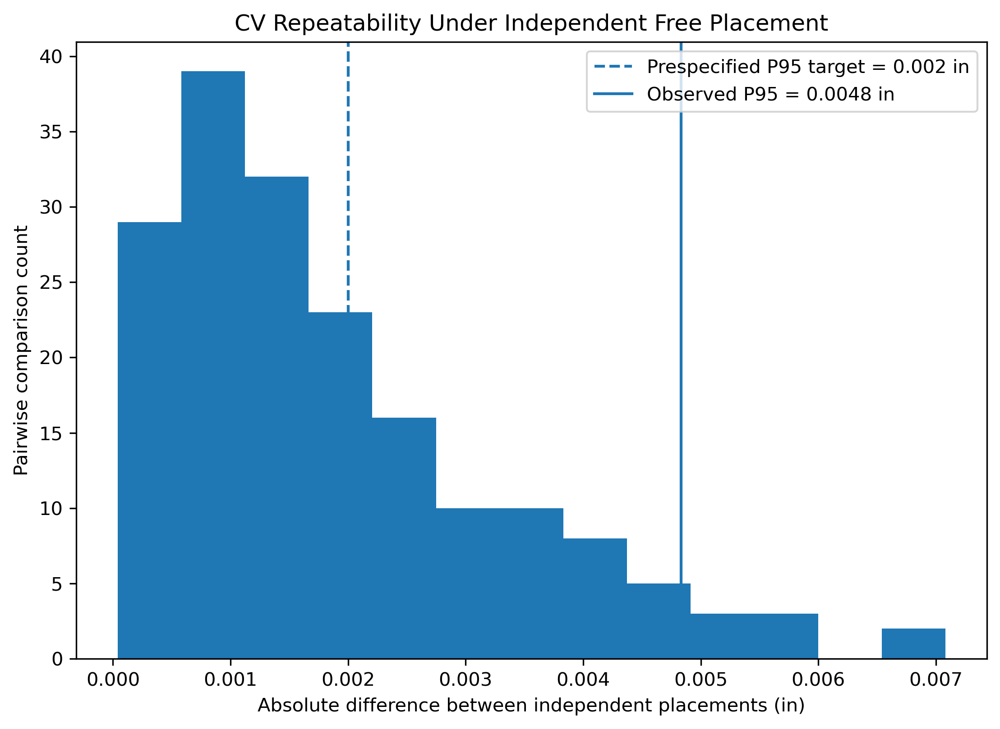
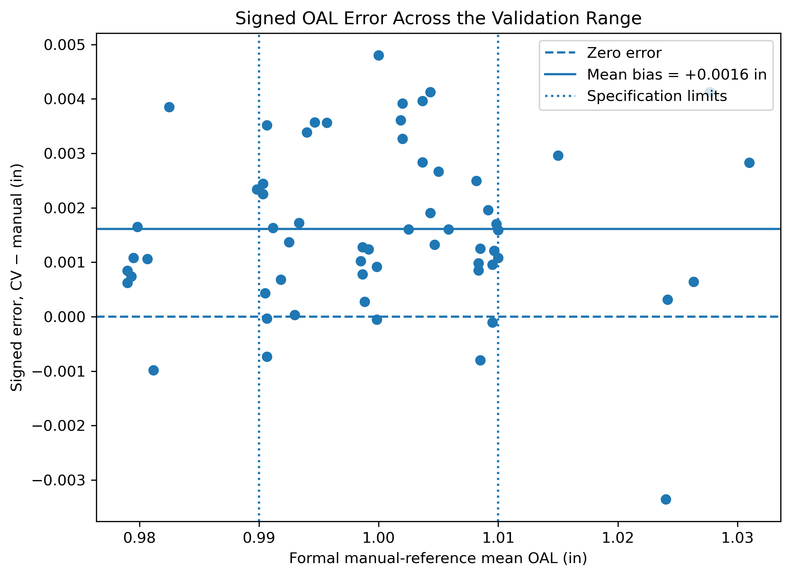
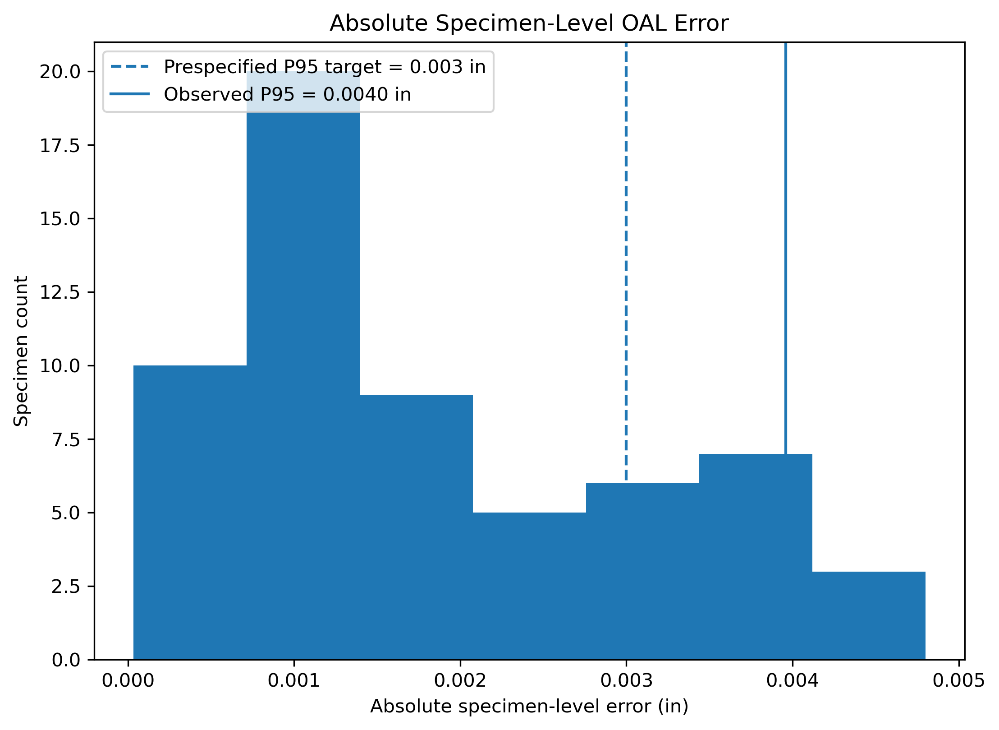
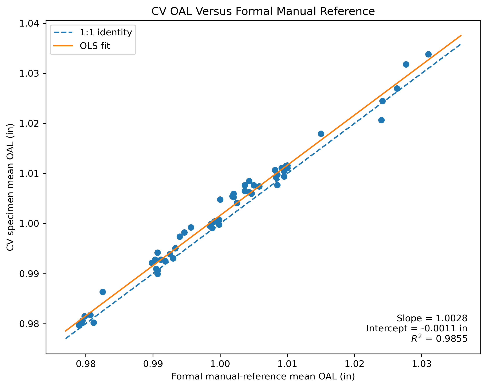
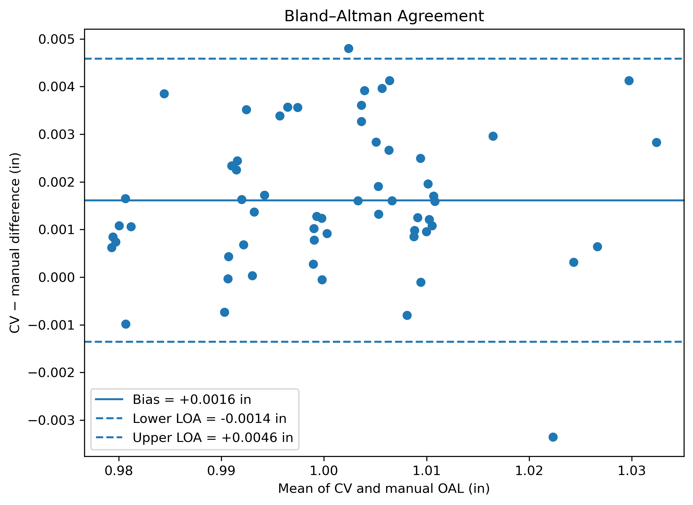
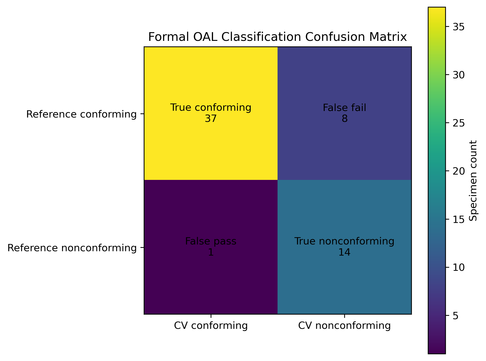
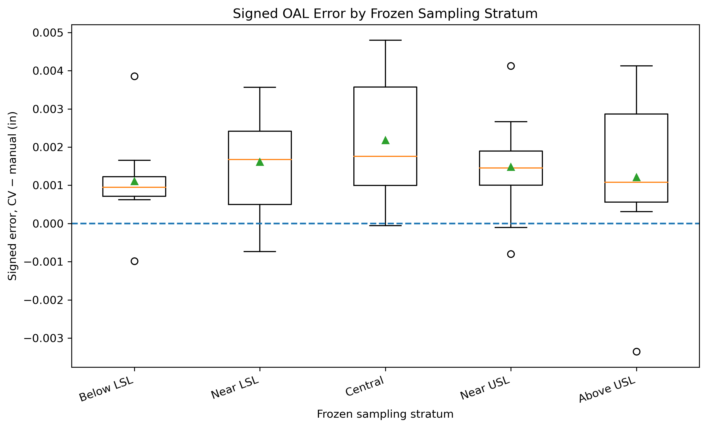
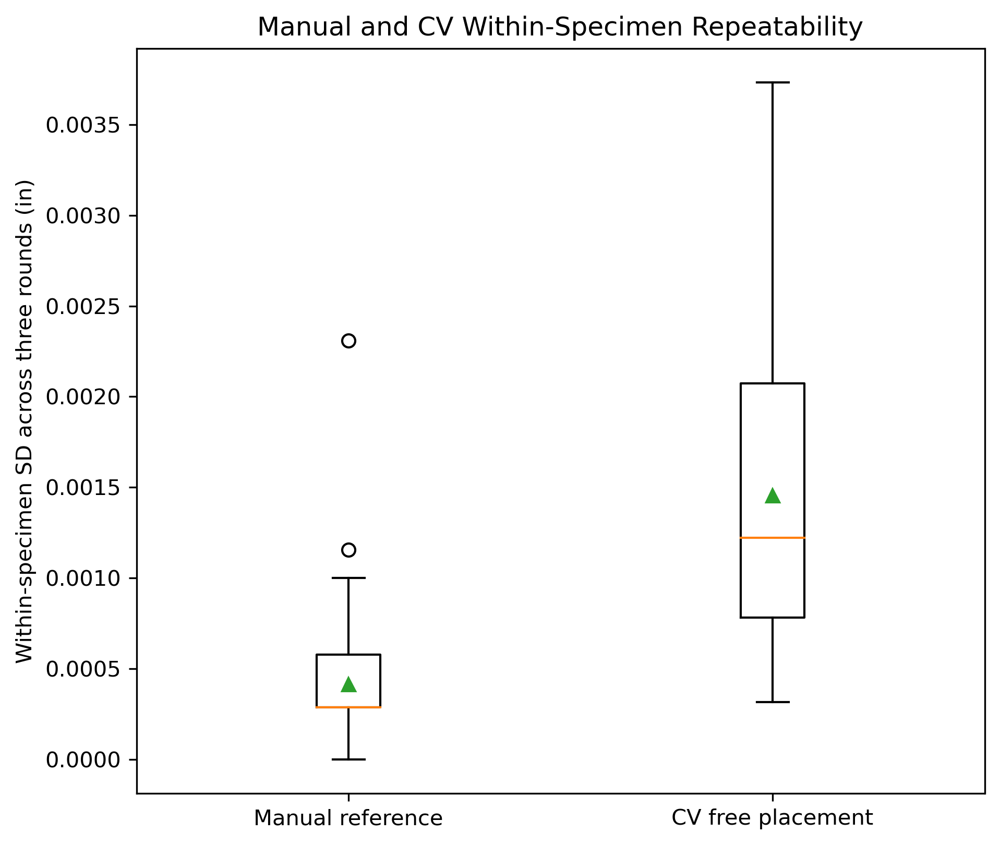
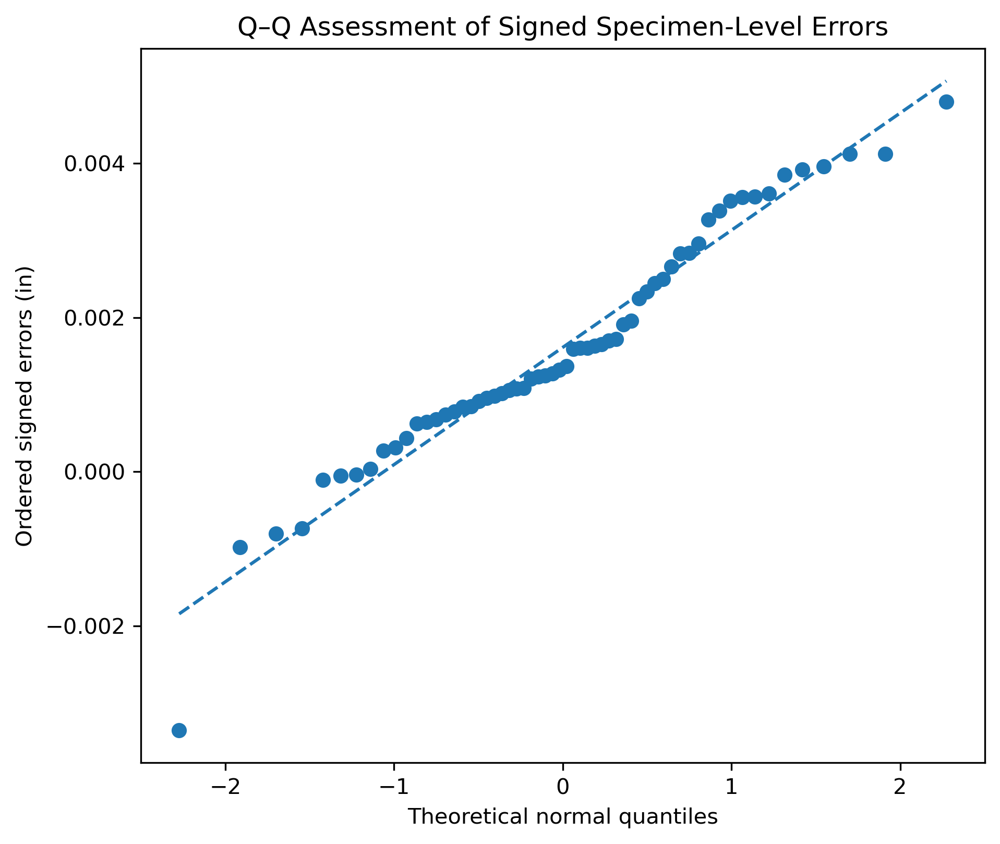

# Chapter 4 — Results

## 4.1 Formal OAL Validation Overview

Formal validation of the CaseMetrology overall-length (OAL) measurement system was conducted using the prospectively frozen set of 60 uniquely identified cartridge-case specimens. The same retained specimen set was used throughout the manual-reference and computer-vision (CV) phases.

Three randomized manual-reference measurement rounds and three randomized CV measurement rounds were completed. The resulting formal dataset contained 180 valid manual-reference measurements and 180 valid CV measurements, for a total of 360 formal specimen measurements.

The primary statistical unit was the unique specimen rather than the individual replicate. Accordingly, primary dimensional agreement was evaluated using 60 paired specimen-level means, with each manual and CV mean based on three valid measurements.

Formal V1 CV acquisition used independent free placement on the clear Lexan measurement surface. The installed Lexan locator was not used to mechanically constrain specimen position. Gross base-to-mouth orientation was maintained, while exact image-plane position and small angular variation were otherwise unconstrained. Detailed acquisition conditions are described in Chapter 3.

## 4.2 Formal Dataset Integrity and Measurement Availability

All three manual-reference sessions satisfied the frozen session-acceptance criteria and were classified as accepted.

Two manual-reference measurements obtained during the second manual round were designated protocol-invalid after a temporary run-order sequence displacement was detected. The two observations were preserved in the raw dataset for traceability, excluded from formal analysis, and replaced by measurements obtained in the correct frozen sequence. The resulting formal manual-reference analysis population contained exactly 180 valid measurements, with three valid observations for each of the 60 specimens.

All 180 planned formal CV observations returned a `VALID` measurement status. No CV observation was classified as a system failure. Formal CV measurement availability was therefore:

\[
Availability = 100.0\%
\]

which exceeded the prespecified minimum criterion of 99%.

## 4.3 Manual Reference Repeatability and Reference Uncertainty

For specimen \(i\), the formal manual reference was calculated from the three valid randomized manual observations:

\[
\bar{M}_i =
\frac{M_{i1}+M_{i2}+M_{i3}}{3}
\]

Screening measurements used during sample selection were not included in the formal reference value.

The pooled within-specimen manual repeated-measurement standard deviation was:

\[
s_p = 0.000553\text{ in}
\]

The prospectively frozen reference-uncertainty model combined the accredited calibration uncertainty contribution, digital display-resolution contribution, and pooled repeated-measurement contribution.

The resulting expanded formal reference uncertainty was:

\[
U_{ref}=0.000712\text{ in}
\]

using a coverage factor of \(k=2\).

The expanded uncertainty did not alter the primary specification classification. Instead, the frozen analysis plan required a secondary uncertainty-overlap flag when a specimen's reference-uncertainty interval reached or crossed either nominal specification limit. Thirteen of the 60 formal specimens met this secondary overlap criterion.

## 4.4 CV Repeatability Under Independent Free Placement

Formal CV repeatability was evaluated using the three independent specimen placements obtained for each of the 60 specimens. For each specimen, the absolute differences between CV Rounds 1 and 2, Rounds 1 and 3, and Rounds 2 and 3 were calculated, producing 180 pairwise differences.

The empirical nearest-rank 95th-percentile pairwise difference was:

\[
P_{95}=0.004831\text{ in}
\]

The maximum observed pairwise difference was:

\[
0.007081\text{ in}
\]

The prospectively specified criterion required:

\[
P_{95}\le0.002\text{ in}
\]

Therefore, the V1 independent-placement repeatability criterion was not met.

The largest observed pairwise difference occurred for specimen 70. Its three CV measurements were 1.003218, 1.010299, and 1.008805 in, yielding a maximum pairwise difference of 0.007081 in.

These pairwise differences therefore quantify V1 placement-dependent repeatability under the independent free-placement acquisition condition defined in Chapter 3.

Figure 4.1 summarizes CV repeated-measurement variation under the independent free-placement acquisition condition.

Source file: `data/oal_validation/derived/figures/figure_v1_independent_placement_repeatability.pdf`

## 4.5 Primary Dimensional Agreement

For each specimen, signed measurement error was prospectively defined as:

\[
e_i=\bar{C}_i-\bar{M}_i
\]

where \(\bar{C}_i\) is the mean formal CV OAL and \(\bar{M}_i\) is the mean formal manual-reference OAL.

Positive error indicates that the CV method reported a longer OAL than the corresponding manual reference.

The observed mean signed error was:

\[
Bias=+0.001613\text{ in}
\]

with a 95% confidence interval of:

\[
[+0.001222,\,+0.002005]\text{ in}
\]

The median signed error was:

\[
+0.001345\text{ in}
\]

The mean absolute error was:

\[
MAE=0.001815\text{ in}
\]

and root mean square error was:

\[
RMSE=0.002205\text{ in}
\]

The empirical nearest-rank 95th-percentile absolute specimen error was:

\[
P_{95}(|e|)=0.003960\text{ in}
\]

and the maximum absolute specimen error was:

\[
E_{max}=0.004799\text{ in}
\]

The observed mean signed error was positive.

Figure 4.2 shows signed specimen-level OAL error as a function of formal manual-reference OAL.

Source file: `data/oal_validation/derived/figures/figure_v1_signed_error_vs_reference.pdf`

Figure 4.3 shows the distribution of absolute specimen-level OAL error.

Source file: `data/oal_validation/derived/figures/figure_v1_absolute_error_distribution.pdf`

## 4.6 Prespecified Formal Validation Criteria

Table 4.1 summarizes the primary prespecified V1 validation criteria and observed outcomes.

### Table 4.1. Prespecified V1 formal OAL validation criteria

| Metric | Observed | Prespecified criterion | Status |
|---|---:|---:|---|
| CV measurement availability | 100.000% | >= 99% | MET |
| Independent-placement pairwise P95 | 0.004831 in | <= 0.002 in | NOT MET |
| Absolute mean bias | 0.001613 in | <= 0.001 in | NOT MET |
| RMSE | 0.002205 in | <= 0.002 in | NOT MET |
| P95 absolute specimen error | 0.003960 in | <= 0.003 in | NOT MET |
| Maximum absolute specimen error | 0.004799 in | <= 0.004 in | NOT MET |
| False passes | 1 | Zero preferred | NOT MET |

The system therefore met the measurement-availability requirement but did not satisfy the prespecified V1 targets for placement-dependent repeatability, absolute mean bias, RMSE, 95th-percentile absolute specimen error, maximum absolute specimen error, or the preferred zero-false-pass condition.

Under the frozen statistical analysis plan, failure of one or more criteria did not authorize retrospective adjustment of the validation dataset, calibration model, estimator, acceptance thresholds, or specimen classifications.

## 4.7 CV Versus Manual Reference Relationship

Linear regression of specimen-level CV mean OAL against formal manual-reference mean OAL produced:

\[
Slope=1.002761
\]

and:

\[
Intercept=-0.001148\text{ in}
\]

Pearson correlation was:

\[
r=0.992737
\]

with:

\[
R^2=0.985526
\]

Correlation and \(R^2\) were prospectively defined as secondary diagnostic measures rather than primary agreement criteria.

Figure 4.4 compares CV specimen-level mean OAL with formal manual-reference mean OAL and includes the 1:1 identity line and ordinary least-squares fit.

Source file: `data/oal_validation/derived/figures/figure_v1_cv_vs_manual.pdf`

## 4.8 Bland–Altman Agreement

Bland–Altman analysis was performed using the 60 paired specimen-level means.

The mean paired difference was:

\[
+0.001613\text{ in}
\]

The calculated 95% limits of agreement were:

\[
LOA_{lower}=-0.001357\text{ in}
\]

and:

\[
LOA_{upper}=+0.004583\text{ in}
\]

The specimen-level paired differences were distributed around the positive mean bias within these calculated limits of agreement.

Figure 4.5 presents the Bland–Altman difference-versus-magnitude assessment for the paired specimen-level means.

Source file: `data/oal_validation/derived/figures/figure_v1_bland_altman.pdf`

## 4.9 Specification Classification Performance

The frozen nominal specification limits were:

\[
0.9900\le OAL\le1.0100\text{ in}
\]

inclusive.

Primary reference classification was determined from the formal three-reading manual-reference mean. CV classification used the corresponding three-reading CV mean and the same nominal limits.

The formal confusion-matrix results were:

- true conforming: 37 specimens;
- false fails: 8 specimens;
- false passes: 1 specimen;
- true nonconforming: 14 specimens.

Sensitivity for detecting nonconforming specimens was:

\[
93.33\%
\]

and specificity for conforming specimens was:

\[
82.22\%
\]

The single false-pass specimen was part 143. Its formal manual-reference mean was 0.989833 in, while its CV mean was 0.992173 in. The resulting signed error was +0.002340 in. Part 143 also met the prospectively frozen uncertainty-overlap criterion.

Eight specimens were classified as false fails. Seven of the eight occurred on the upper side of the nominal specification region. Six of the eight false fails also carried the secondary uncertainty-overlap flag.

The overlap flag did not change the frozen primary classification.

Figure 4.6 summarizes the formal specification-classification outcomes.

Source file: `data/oal_validation/derived/figures/figure_v1_classification_confusion_matrix.pdf`

## 4.10 Error by Frozen Sampling Stratum

The five frozen sampling strata were retained for stratified analysis. Strata reflected the original screening-based sampling design and were not reassigned using the final formal manual-reference means.

Table 4.2 summarizes specimen-level dimensional error and classification outcomes across the five frozen sampling strata.

### Table 4.2. V1 dimensional error by frozen sampling stratum

| Frozen sampling stratum | n | Mean signed error (in) | MAE (in) | Maximum absolute error (in) | False passes | False fails |
|---|---:|---:|---:|---:|---:|---:|
| Below LSL | 8 | +0.001109 | 0.001355 | 0.003853 | 0 | 0 |
| Near LSL, in specification | 14 | +0.001615 | 0.001725 | 0.003567 | 1 | 1 |
| Central nominal | 16 | +0.002182 | 0.002189 | 0.004799 | 0 | 0 |
| Near USL, in specification | 14 | +0.001480 | 0.001609 | 0.004126 | 0 | 5 |
| Above USL | 8 | +0.001210 | 0.002049 | 0.004124 | 0 | 2 |

Mean signed error was positive in all five frozen sampling strata.

The central-nominal stratum exhibited the greatest mean signed error at +0.002182 in and the largest observed specimen-level absolute error at 0.004799 in. No classification errors occurred in that stratum.

Classification errors occurred in the near-LSL, near-USL, and above-USL strata, with the largest count occurring in the near-USL stratum.

Figure 4.7 shows signed specimen-level OAL error across the five frozen sampling strata.

Source file: `data/oal_validation/derived/figures/figure_v1_error_by_stratum.pdf`

## 4.11 Manual and CV Within-Specimen Repeatability

Within-specimen standard deviations were calculated separately for the three formal manual-reference measurements and three formal CV measurements for each specimen.

The manual-reference repeatability results characterize the single-operator calibrated manual method. They do not constitute a multi-operator Gage R&R study.

The CV within-specimen results characterize repeatability across three independent free placements within the camera viewing field rather than repeatability at one mechanically fixed position.

Figure 4.8 compares within-specimen repeated-measurement behavior for the manual-reference and CV methods.

Source file: `data/oal_validation/derived/figures/figure_v1_repeatability_comparison.pdf`

## 4.12 Signed-Error Distributional Assessment

The frozen statistical analysis plan included distributional assessment of signed specimen-level differences.

A normal Q-Q assessment was produced for the 60 signed specimen-level errors. This diagnostic was used to assess the shape of the error distribution and did not provide a basis for deleting or excluding observations.

Figure 4.9 provides the normal Q-Q assessment of signed specimen-level OAL errors.

Source file: `data/oal_validation/derived/figures/figure_v1_signed_error_qq.pdf`

## 4.13 Post-Validation Exploratory Diagnostics

Following completion, preservation, and interpretation of the primary V1 formal analysis, limited exploratory diagnostics were conducted to characterize the observed failure pattern.

These analyses were not prospectively defined acceptance criteria and did not change the V1 formal outcome.

### 4.13.1 Error by CV Round

Mean signed error differed across the three CV rounds.

Table 4.3 summarizes the exploratory round-specific CV error statistics for the three formal acquisition rounds.

### Table 4.3. Exploratory CV round-specific error

| CV round | n | Mean signed error (in) | Median signed error (in) | SD (in) | MAE (in) |
|---|---:|---:|---:|---:|---:|
| Round 1 | 60 | +0.000764 | +0.000820 | 0.001976 | 0.001697 |
| Round 2 | 60 | +0.001721 | +0.001499 | 0.001988 | 0.002186 |
| Round 3 | 60 | +0.002355 | +0.002519 | 0.001830 | 0.002521 |

The difference between the mean Round 3 and Round 1 errors was:

\[
+0.001591\text{ in}
\]

No meaningful relationship was observed between within-round acquisition sequence and signed measurement error. The sequence-based regressions produced \(R^2\) values of 0.0060, 0.0010, and 0.0027 for Rounds 1, 2, and 3, respectively.

The round-specific means differed, whereas the within-round sequence regressions showed minimal linear association with acquisition sequence.

### 4.13.2 Placement Variability Versus Specimen Agreement Error

The association between each specimen's maximum independent-placement pairwise difference and its specimen-level absolute agreement error was negligible.

Pearson correlation was:

\[
r=-0.083989
\]

and Spearman rank correlation was:

\[
\rho=-0.113087
\]

The observed correlations between maximum placement-dependent variation and specimen-level absolute agreement error were near zero.

### 4.13.3 Signed Error Versus Formal OAL

Signed specimen-level error showed essentially no linear relationship with formal manual-reference OAL.

The error-versus-OAL regression produced:

\[
R^2=0.000516
\]

with:

\[
p=0.863
\]

The fitted relationship between signed error and formal manual-reference OAL was negligible over the observed validation range.

### 4.13.4 Effective PPI

Individual CV observation error showed a moderate negative association with effective pixels per inch (PPI), with Pearson \(r=-0.374732\) and Spearman \(\rho=-0.369283\).

However, effective PPI is an endogenous component of the frozen CaseMetrology dimensional conversion. The production pipeline calculates effective PPI from the spatial calibration planes and specimen orientation and then calculates OAL by dividing measured pixel length by effective PPI.

Because effective PPI is part of the dimensional conversion equation, the observed association is reported as exploratory rather than causal evidence.

Mean effective PPI was similar across the three CV rounds.

## 4.14 Summary of V1 Formal Validation

The V1 CaseMetrology system produced valid OAL measurements for all 180 planned formal CV observations, satisfying the prespecified measurement-availability criterion.

The CV method also exhibited strong linear association with the calibrated manual reference across the validation range.

However, the V1 system did not meet the prospectively defined criteria for independent-placement repeatability, absolute mean bias, RMSE, 95th-percentile absolute specimen error, maximum absolute specimen error, or the preferred zero-false-pass condition.

The formal specimen-level mean bias was +0.001613 in, and the empirical 95th-percentile independent-placement pairwise difference was 0.004831 in.

Classification performance consisted of 37 true-conforming specimens, 14 true-nonconforming specimens, eight false fails, and one false pass.

Signed error was positive in all five frozen sampling strata. Exploratory diagnostics additionally identified an increase in mean signed error across CV rounds but no meaningful progressive within-round sequence trend, no meaningful relationship between signed error and formal OAL, and little association between maximum specimen placement variation and absolute specimen-mean agreement error.

These results constitute the preserved V1 formal validation outcome under the prospectively frozen protocol.
